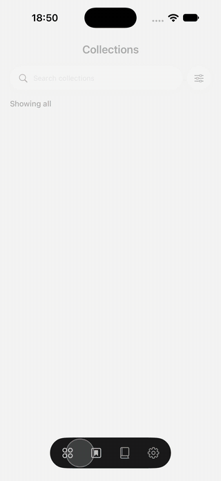

# BookShelf

A recreation of a "Collections" book app concept in Expo SDK 57, with every screen drawn by native
SwiftUI through `@expo/ui`. iOS only. See [PLAN.md](PLAN.md) for the original breakdown of the video.

## Demo

<p align="center"></p>

Full-quality recording from the iOS 27 simulator: [docs/media/demo.mp4](docs/media/demo.mp4). To frame a new
recording the same way, run `scripts/frame-recording.sh <recording.mp4>`.


## Inspiration

Based on the "9 Clever Layering Ideas" concept shared on Pinterest
([pin 852728510751447010](https://www.pinterest.com/pin/852728510751447010/)). All credit for the original
design goes to its creator. The frames below are reference stills from that video, kept for comparison;
the original video isn't redistributed here.


The book covers in this app are original placeholder art generated by `scripts/generate-covers.py`.

## Run

```bash
npm install
LANG=en_US.UTF-8 npx expo run:ios
```

`LANG` must be UTF-8 or CocoaPods fails during `pod install`.

## Where things live

| Path | What |
|------|------|
| `src/app/_layout.tsx` | Tabs (cross-fade) + preloads cover images |
| `src/components/FloatingTabBar.tsx` | Dark floating capsule; the selection disc glides with `matchedGeometryEffect` |
| `src/app/collections.tsx` | List ⇄ detail state machine (`closed → lift → fly → open → land → return`) |
| `src/features/collections/HeroLayer.tsx` | The three covers that fly between the card fan and the shelf |
| `src/features/collections/Shelf.tsx` | Looping, snapping shelf on the wood plank |
| `src/features/collections/CollectionDetail.tsx` | Detail sheet, staggered reveal; back button, grabber tap or pull-down return to the list |
| `scripts/generate-covers.py` | Generates the original placeholder cover art in `assets/covers` |
| `plugins/with-scene-lifecycle.js` | Adopts the UIKit scene life cycle the iOS 27 SDK requires (backport of the SDK 58 template) |

## Expo UI notes learned the hard way

- Expo UI animates **modifier changes** inside `animation(…, value)`, but not views being inserted or
  removed. That rules out SwiftUI's `matchedGeometryEffect` across two screens, so the hero is a
  dedicated overlay whose frame, offset and rotation are animated.
- A view whose **modifier list changes shape** is rebuilt, not animated. Keep the chain identical and
  vary only values (see `Cover.tsx`).
- `onGeometryChange` reports global frames; the overlay subtracts its own origin.
- `scrollPosition`'s initial value is ignored, and setting the same value again does nothing. The shelf
  starts at `null` and jumps to the middle copy in `onAppear`.
